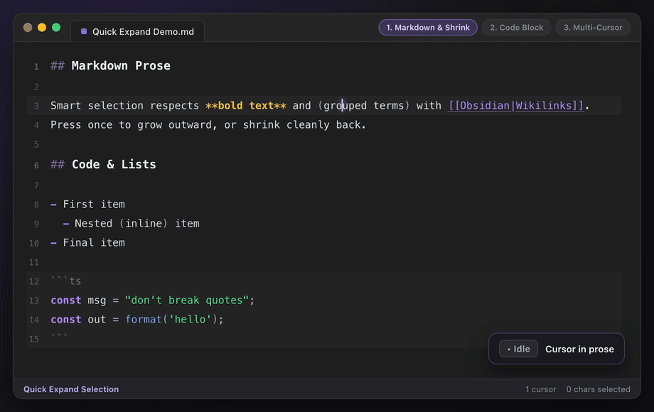

# Quick Expand Selection

**Quick Expand Selection** brings IDE-style, Markdown-aware **Expand Selection** and **Shrink Selection** commands to Obsidian—so you can progressively grow or shrink text selections without reaching for the mouse.



---

## Features

- **Layered, Markdown-aware expansion** — Smoothly expands from the innermost token outward through inline formatting, lines, paragraphs, lists, code blocks, LaTeX math, heading sections, document body, and the full document.
- **Inner-then-outer delimiter matching** — Selects inner content first, then includes the surrounding delimiters for:
  - Brackets and quotes: `(...)`, `[...]`, `{...}`, `"..."`, `'...'`
  - Markdown inline syntax: `**bold**`, `__underline__`, `~~strikethrough~~`, `==highlight==`, `` `code` ``, ```` ``code`` ````
  - Obsidian wikilinks: `[[Note|Alias]]`
  - CJK brackets and quotes: `（…）`, `【…】`, `「…」`, `『…』`, `《…》`, `“…”`, `‘…’`
- **IDE-style fenced code blocks** — Handles string quotes safely (even with apostrophes like `"don't"`), distinguishes single-line vs. multi-line brackets, selects the inner code body before the full fenced block, and ignores `#` comments so they never break Markdown heading sections.
- **Nested LaTeX math support** — Expands nested environments innermost-first (e.g., `\begin{aligned}` inside `$$...$$`) while ignoring plain currency amounts like `$5 ... $10`.
- **CJK word segmentation** — Uses `Intl.Segmenter` so a collapsed cursor in Chinese or Japanese prose selects an individual word before expanding to the full character run.
- **Full multi-cursor support** — Expands and shrinks each cursor independently, cleanly handles merging at full-document scope, and restores all cursors when shrinking back.
- **Reliable shrink history** — Steps cleanly back through every expansion level—including from full-document selections and notes with YAML frontmatter / Live Preview properties—and collapses to a cursor when no history remains.
- **Configurable & localized** — Every rule can be toggled individually in settings. UI strings automatically follow Obsidian's interface language (English fallback + Simplified Chinese). Works on both desktop and mobile.

---

## Commands & Hotkeys

| Command (EN) | Command (简体中文) | Description |
| :--- | :--- | :--- |
| `Expand selection` | `扩选文本` | Expand the current selection(s) to the next larger structural scope. |
| `Shrink selection` | `缩选文本` | Step back to the previous selection(s) in history, or collapse to a cursor. |

No default hotkeys are assigned so the plugin never conflicts with existing Obsidian or custom bindings. Assign your preferred shortcuts in **Settings → Hotkeys**, for example:

- **macOS (JetBrains-style)**: `Option + ↑` (Expand) / `Option + ↓` (Shrink)
- **Windows / Linux (VS Code-style)**: `Shift + Alt + →` (Expand) / `Shift + Alt + ←` (Shrink)

---

## Expansion Progression Examples

### Markdown Prose & Headings

Starting from a collapsed cursor inside `grouped` in a note under `## Markdown Prose`:

```text
grouped
  → grouped terms              (inner pair)
  → (grouped terms)            (outer pair)
  → " (grouped terms) "        (adjacent whitespace / punctuation)
  → Current line
  → Current paragraph
  → Enclosing heading section  (## Markdown Prose …)
  → Document body              (skips YAML frontmatter if present)
  → Full document
```

### Fenced Code Blocks

Starting from `hello` inside `const out = format('hello');`:

```text
hello
  → 'hello'                    (quoted string)
  → ('hello')                  (inline parentheses)
  → const out = format('hello'); (code line)
  → Multi-line enclosing block (if any)
  → Code body                  (inner lines without ``` fences)
  → Full fenced code block     (including ``` fences)
  → Enclosing heading section
  → Full document
```

### Nested Lists

Starting from `inline` inside `  - Nested (inline) item`:

```text
inline
  → (inline)                   (inline pair)
  → Nested (inline) item       (list item content)
  → - Nested (inline) item     (list item with marker)
  → Nested list block
  → Parent list block
  → Enclosing heading section
  → Full document
```

### LaTeX Math

Starting from `b` inside `$$\n\begin{aligned}\na + b = c\n\end{aligned}\n$$`:

```text
b
  → \begin{aligned} ... \end{aligned}  (inner environment)
  → $$ ... $$                          (outer math block)
  → Enclosing heading section
  → Full document
```

### CJK Text

Starting from a collapsed cursor between `写` and `作` in `写作很重要。下一句。`:

```text
写作
  → 写作很重要                 (full CJK word run)
  → 写作很重要。               (adjacent punctuation)
  → 写作很重要。下一句。       (line / token)
  → Paragraph → Heading section → Full document
```

---

## Settings

Open **Settings → Quick Expand Selection** to enable or disable individual expansion layers:

| Rule | Default | Behavior |
| :--- | :---: | :--- |
| **Whitespace** | On | Treat consecutive spaces and tabs as intermediate expansion boundaries. |
| **Punctuation and symbols** | On | Treat Markdown markers, punctuation, and symbols as expansion boundaries. |
| **Paragraphs and lines** | On | Expand to the current line, then to the enclosing paragraph. |
| **List hierarchy** | On | Expand through list-item content, list item with marker, nested list block, and parent list blocks. |
| **Code blocks** | On | Use IDE-style pair/line/body/fence expansion inside fenced code blocks. |
| **LaTeX** | On | Recognize inline math (`$...$`, `\(...\)`), display math (`$$...$$`, `\[...\]`), and `\begin{...}...\end{...}` environments. |
| **Heading hierarchy** | On | Expand the current heading line and progressively through enclosing heading sections. |

You can also use **Reset expansion history** in settings to clear stored expansion history across open editors.

---

## Installation

### Manual Installation (GitHub Releases)

1. Download `main.js` and `manifest.json` from the [latest release](https://github.com/MuShan-bit/quick-expand-selection/releases/latest).
2. Create the folder `<vault>/.obsidian/plugins/quick-expand-selection/` and copy both files into it.
3. Reload Obsidian and enable **Quick Expand Selection** in **Settings → Community plugins**.
4. Assign hotkeys in **Settings → Hotkeys**.

---

## Development

```bash
npm install
npx tsc --noEmit
npm test
npm run build
```

Copy the built `main.js` and `manifest.json` into:

```text
<vault>/.obsidian/plugins/quick-expand-selection/
```
